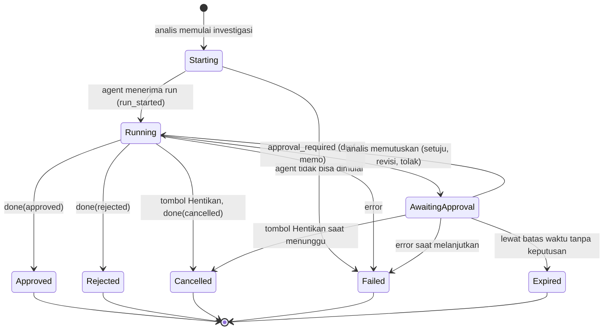
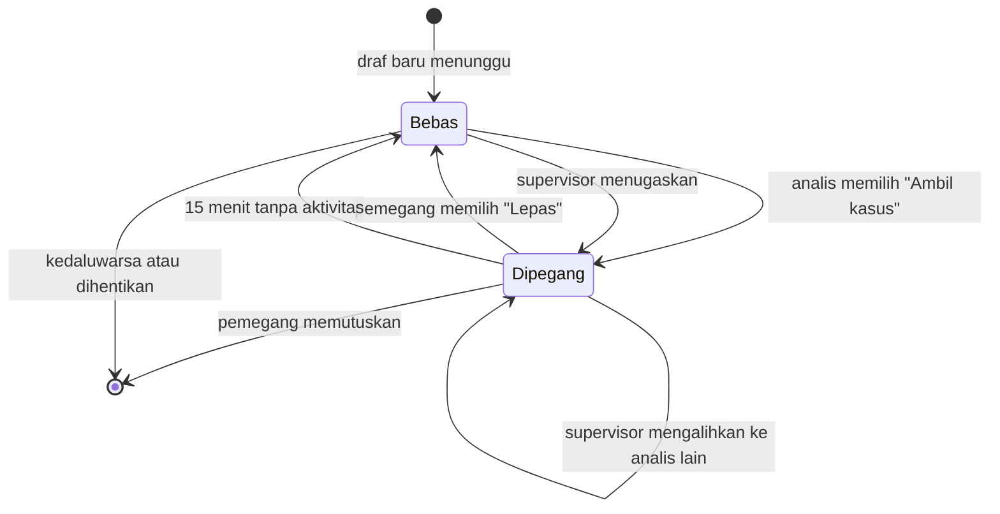

# Status kasus dan alur approval

Diagram ini sama dengan tabel transisi di
`app/Surveillance.Web/Investigations/CaseStateMachine.cs`. Test
`CaseStateMachineTests` memeriksa setiap pasangan status, jadi diagram dan
kode tidak bisa diam-diam berbeda tanpa test yang gagal.

## Status kasus

- Status yang sama boleh terulang selama run belum selesai, misalnya banyak event saat `Running`.
- Status akhir (`Approved`, `Rejected`, `Cancelled`, `Failed`, `Expired`) tidak bisa berubah lagi.
- Event yang meminta transisi yang tidak sah tetap disimpan, tetapi status tidak berubah dan aplikasi menulis peringatan di log. Contohnya: event setelah `done`, atau `done(cancelled)` milik run yang kasusnya sudah `Expired`.
- Revisi kembali lewat `Running`. Keputusan "revisi" memindahkan kasus ke `Running`, lalu agent mengajukan draf baru, sehingga kasus kembali ke `AwaitingApproval`. Batas waktu dihitung ulang dari draf baru (`AwaitingSince`).

## Siapa memegang kasus selama menunggu

- Pegangan bukan status kasus tersendiri. Pegangan adalah kolom `ClaimedBy`, `ClaimedByUser`, dan `ClaimActivityAt` yang hanya berarti selama kasus `AwaitingApproval`. Keputusan dan kedaluwarsa mengosongkannya, jadi draf berikutnya harus diambil lagi.
- **Pegangan yang aktif menolak keputusan dari analis lain** (HTTP 409 "Kasus ini sedang dipegang oleh …").
- **Kasus yang belum dipegang tetap bisa diputuskan.** Server menerima keputusan itu, supaya keputusan tidak hilang hanya karena langkah ambil terlewat. Di antarmuka, tombol keputusan aktif hanya setelah analis memilih "Ambil kasus".
- **Setiap perubahan pegangan adalah update bersyarat dan tercatat di `CaseAuditRecords`.** Ini berlaku untuk ambil, lepas, dan alihkan. Kode: `CaseClaims.cs`.

## Konkurensi dan kedaluwarsa

Tiga hal bisa terjadi pada draf yang sama hampir bersamaan: keputusan analis,
kedaluwarsa, dan tombol Hentikan. Ketiganya memakai update bersyarat pada
baris kasus, jadi hanya satu yang menang:

| Pelaku | Syarat update | Bila kalah |
|---|---|---|
| Keputusan analis (`InvestigationService.DecideAsync`) | `Status = AwaitingApproval` dan pegangan kosong, milik dia, atau sudah lewat 15 menit | `AlreadyDecided` (409 "sudah diputuskan oleh …") atau `ClaimedByOther` (409 "sedang dipegang oleh …"); agent tidak disentuh |
| Kedaluwarsa (`ApprovalExpiryService`) | `Status = AwaitingApproval` dan `AwaitingSince` sama dengan yang dibaca | Dilewati; draf sudah diputuskan, dihentikan, atau diganti |
| Tombol Hentikan | Kasus belum selesai | Run sudah selesai; tidak ada yang dihentikan |

Saat kedaluwarsa menang, langkahnya:

1. Kasus menjadi `Expired`.
2. Aplikasi mencatat keputusan `expire` oleh "Sistem", beserta alasannya.
3. Aplikasi memanggil jalur yang sama dengan tombol Hentikan.
4. Agent menutup `submit_memo` yang masih terbuka dan memancarkan `done(cancelled)`.

Event itu tetap disimpan, tetapi status kasus tetap `Expired`. Analis yang
memutuskan sesudahnya mendapat pesan "sudah diputuskan oleh Sistem".

Batas waktu diatur di bagian `Approval` di `appsettings.json`:

| Pengaturan | Nilai awal |
|---|---|
| Kedaluwarsa | 24 jam |
| Penanda "hampir kedaluwarsa" | 4 jam sebelum batas, tetapi tidak lebih dari separuh batas waktu |
| Pegangan lepas | Setelah 15 menit tanpa aktivitas |
| Pemeriksaan | Setiap 30 detik |

Kasus yang dimulai dari `/lab/approval` memakai batas 2 menit
(`InvestigationCase.ApprovalTimeoutMinutes`).

## Garis waktu audit

`/investigations/{id}/audit` (ekspor: `/investigations/{id}/audit.json`)
menggabungkan tiga sumber berdasarkan waktu. Event agent tidak diubah. Sesuai
Keputusan kontrak, keputusan analis tidak dimasukkan ke aliran event.

| Sumber | Tabel | Contoh |
|---|---|---|
| Agent | `Events` (event `token` berurutan digabung menjadi satu narasi) | `approval_required`, `tool_call_finished`, `done` |
| Analis | `Decisions` | "Setuju untuk approval_2" oleh Marthen Rumbiak |
| Aplikasi | `CaseAuditRecords`, ditambah keputusan `expire` | ambil, lepas, alihkan, kedaluwarsa |

Kode: `AuditTimeline.cs`, `Views/Investigation/Audit.cshtml`.
