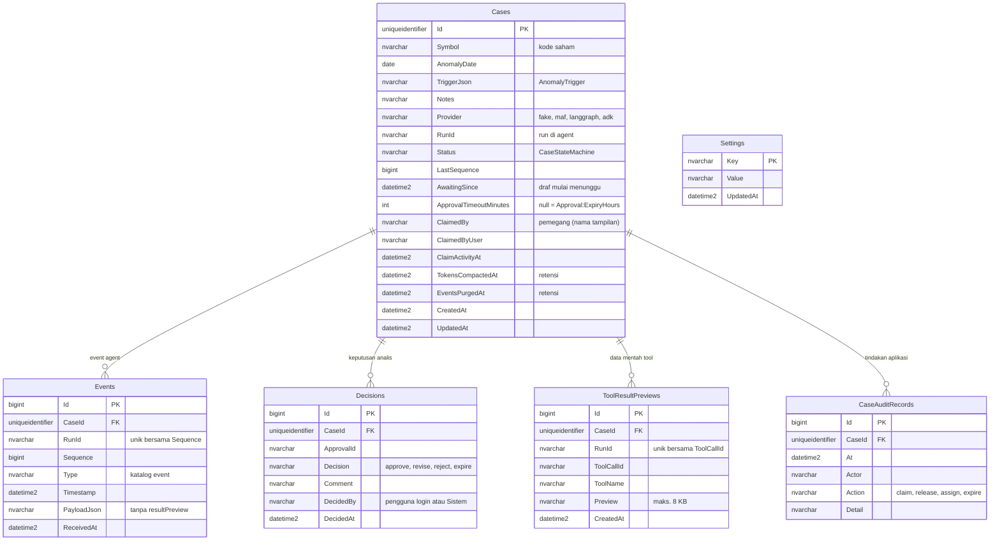

# Skema database aplikasi

Database milik aplikasi (SQL Server atau Azure SQL) adalah sumber kebenaran
untuk kasus, event, dan keputusan. State internal tiap framework agent (file
`App_Data/maf-runs`, `checkpoints.db` LangGraph, `sessions.db` ADK) hanya
dipakai untuk melanjutkan eksekusi.

Diagram ini mengikuti model EF Core di
`app/Surveillance.Web/Data/SurveillanceDbContext.cs` dan migrasi di
`Data/Migrations/`. Skrip DDL lengkap ada di `docs/schema.sql`, dibuat dengan
perintah berikut:

```powershell
cd app/Surveillance.Web
dotnet ef migrations script --idempotent --output ../../docs/schema.sql
```



## Indeks penting

| Tabel | Indeks | Gunanya |
|---|---|---|
| `Events` | Unik `(RunId, Sequence)` | Menangkap event ganda tanpa query tambahan (`docs/NOTES-PERSIST.md`) |
| `Events` | `(CaseId, Sequence)` | Putar ulang dan `events.json?after=` |
| `Cases` | `(Status, AwaitingSince)` | Antrean approval dan pemeriksaan kedaluwarsa |
| `ToolResultPreviews` | Unik `(RunId, ToolCallId)` | Satu pratinjau per panggilan tool |
| `CaseAuditRecords` | `(CaseId, At)` | Garis waktu audit |

## Akses data

Semua akses lewat repository di `app/Surveillance.Web/Data/Repositories/`.
`RepositoryBoundaryTests` memastikan tidak ada `DbContext` yang dipakai di luar
folder `Data` dan `Program.cs`.

| Repository | Isi |
|---|---|
| `ICaseRepository` | Kasus: buat, baca, daftar, antrean, run aktif, cursor untuk `RunPump` |
| `IEventRepository` | Event dan pratinjau: tambah dalam satu perjalanan ke database, putar ulang, retensi |
| `IApprovalRepository` | Keputusan, pegangan kasus, kedaluwarsa (semuanya update bersyarat), dan audit |
| `ISettingsRepository` | Solusi agent aktif dari halaman Setting |
